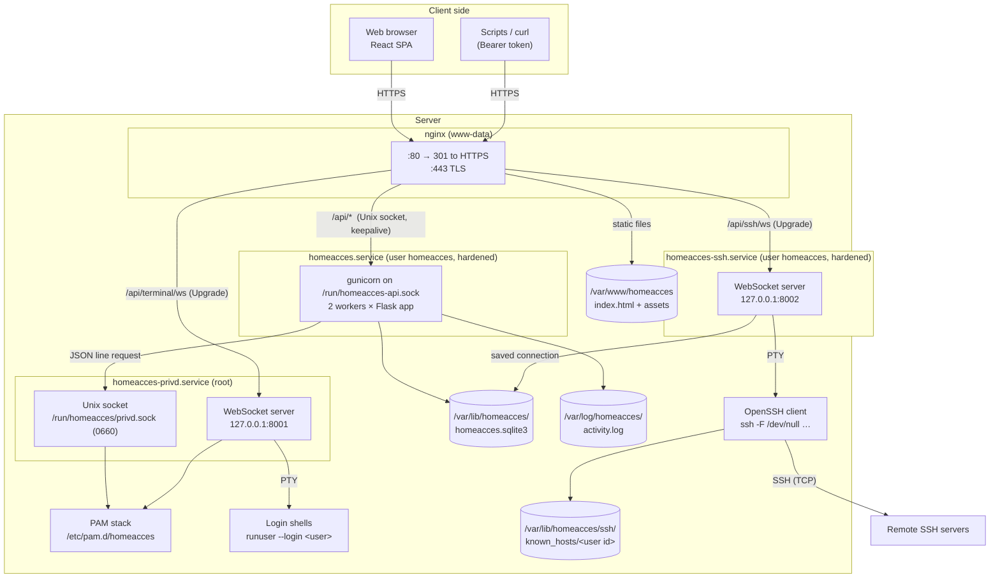
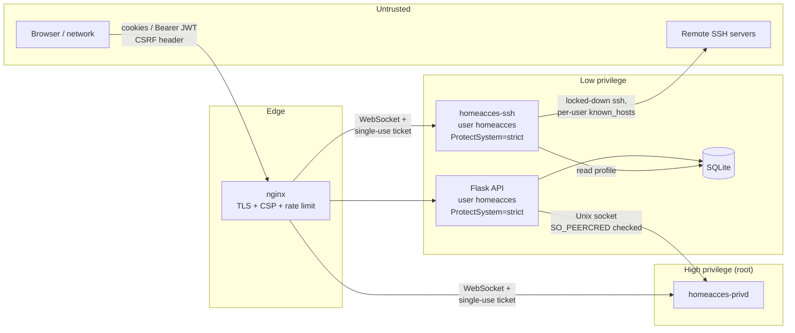
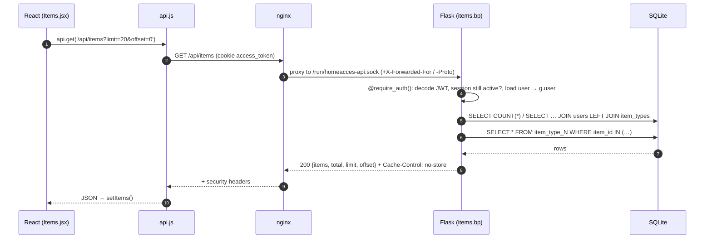
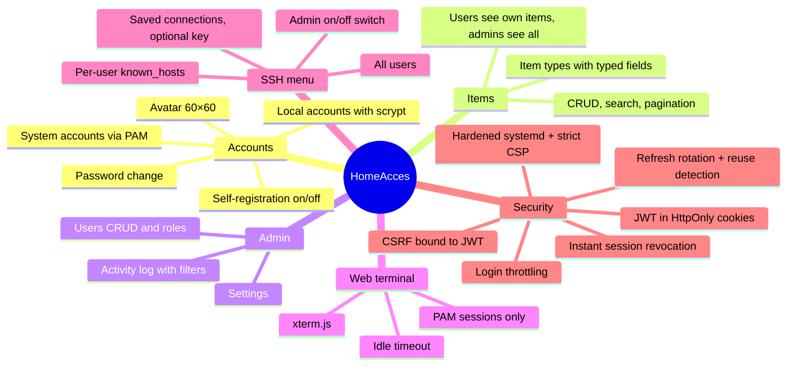

# 1. Architecture overview

[← Index](README.md) · Next: [Backend →](02-backend.md)

HomeAcces is a small full-stack web application designed to run on a small Debian 13 server.
It provides:

- user accounts (local accounts stored in SQLite, or Linux **system accounts** through PAM),
- a personal list of **items**, optionally with admin-defined **item types** carrying typed fields,
- an **admin area** (user management, runtime settings, activity log),
- a **web terminal** (a real login shell in the browser) for users signed in with a system account,
- an **SSH menu** for every user: saved SSH connections, opened in the browser with the OpenSSH client.

## 1.1 Components and processes

Four long-running processes cooperate on the server. Each runs with the least privilege it needs.

| Process | systemd unit | Runs as | Listens on | Role |
|---|---|---|---|---|
| nginx | `nginx.service` | `www-data` | `:80`, `:443` | TLS, security headers, rate limits, static files, reverse proxy |
| API | `homeacces.service` + `homeacces.socket` | `homeacces` (no shell, no capabilities) | `/run/homeacces-api.sock` (only `www-data` may connect) | All business logic: auth, items, types, users, admin |
| Privileged helper | `homeacces-privd.service` | `root` | `127.0.0.1:8001` + Unix socket | PAM password/account checks, web terminal shells |
| SSH terminal | `homeacces-ssh.service` | `homeacces` (hardened, no capabilities) | `127.0.0.1:8002` | Runs the OpenSSH client for the SSH menu |

### Why split the backend into two processes?

Verifying another user's Linux password (`pam_unix` reads `/etc/shadow`) and starting a shell
as that user both require root. Running the whole web API as root would be dangerous, so the
root-only work is isolated in a small, auditable helper (`backend/homeacces_privd/` plus the shared
WebSocket ↔ PTY bridge `backend/webterm.py`, ~500 lines) that:

- only accepts connections on localhost and on a Unix socket restricted (via `SO_PEERCRED`)
  to root and the `homeacces` user,
- applies its own account policy (uid ≥ 1000, member of `homeacces-pam`) on every request,
- trusts nothing from the browser except a short-lived signed **ticket**.

The SSH terminal needs no root at all, so it is **not** part of the helper: `homeacces-ssh`
(`backend/homeacces_ssh/`) runs as `homeacces` and reuses the same bridge and ticket scheme. It is
separate from gunicorn because terminal WebSockets are long-lived and need an asyncio server.

## 1.2 Trust boundaries

## 1.3 URL routing

nginx decides where each request goes:

| Path | Destination | Notes |
|---|---|---|
| `http://…/*` | 301 → `https://…` | HTTP is only a redirect |
| `/api/auth/login`, `/register`, `/token`, `/password` | gunicorn (Unix socket) | Extra nginx rate limit: 10 req/min per IP, burst 5 |
| `/api/terminal/ws` | homeacces-privd `:8001` | WebSocket upgrade, 1 h read/send timeout, max 8 connections per IP |
| `/api/ssh/ws` | homeacces-ssh `:8002` | Same as above; shares the 8-per-IP limit with `/api/terminal/ws` |
| `/api/*` | gunicorn (Unix socket) | via `snippets/homeacces-proxy.conf` |
| `/assets/*` | files in `/var/www/homeacces/assets` | Content-hashed names → cached 1 year, `immutable` |
| anything else | `/var/www/homeacces/index.html` | SPA fallback, `Cache-Control: no-cache`; React Router handles the path |

## 1.4 A typical request, end to end

Listing items after the user is signed in:

If the access token has expired, step 4 returns `401`, and `api.js` transparently calls
`POST /api/auth/refresh` once and retries (see [Authentication](04-authentication.md#45-token-refresh-and-rotation)).

## 1.5 Feature map

