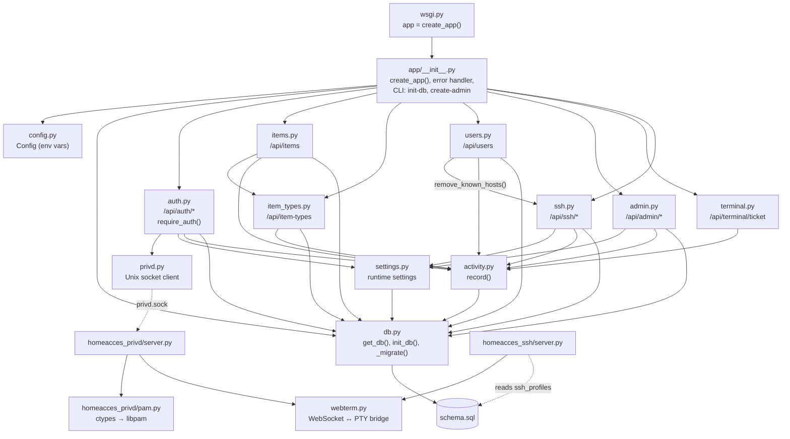
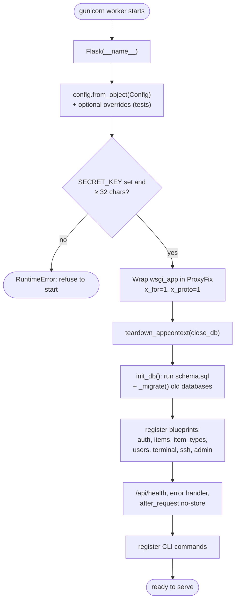
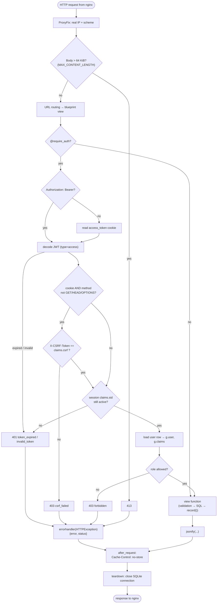
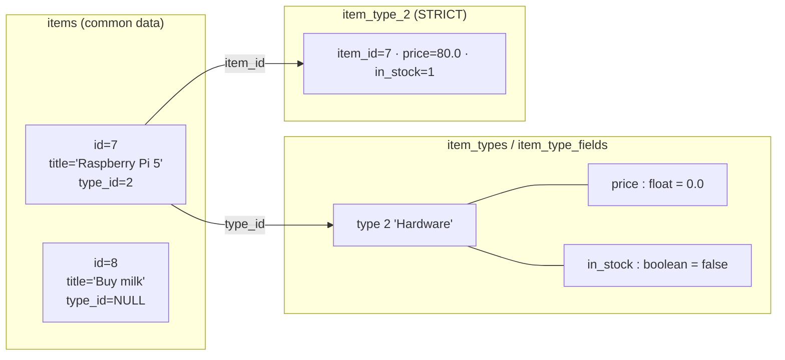
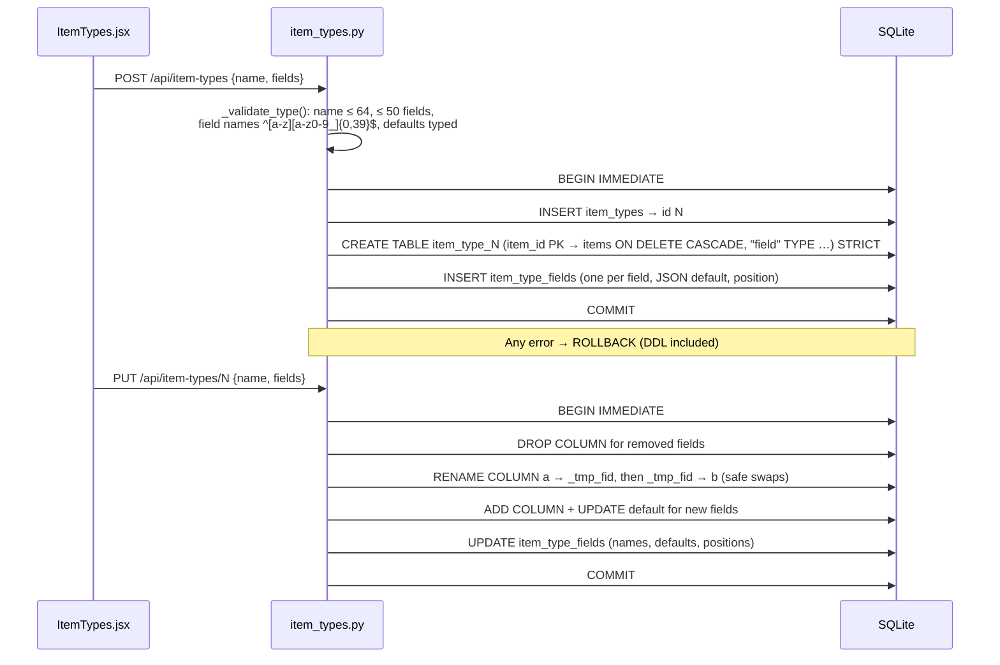
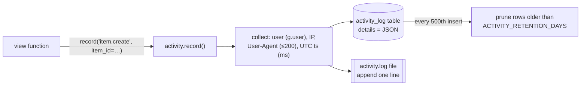
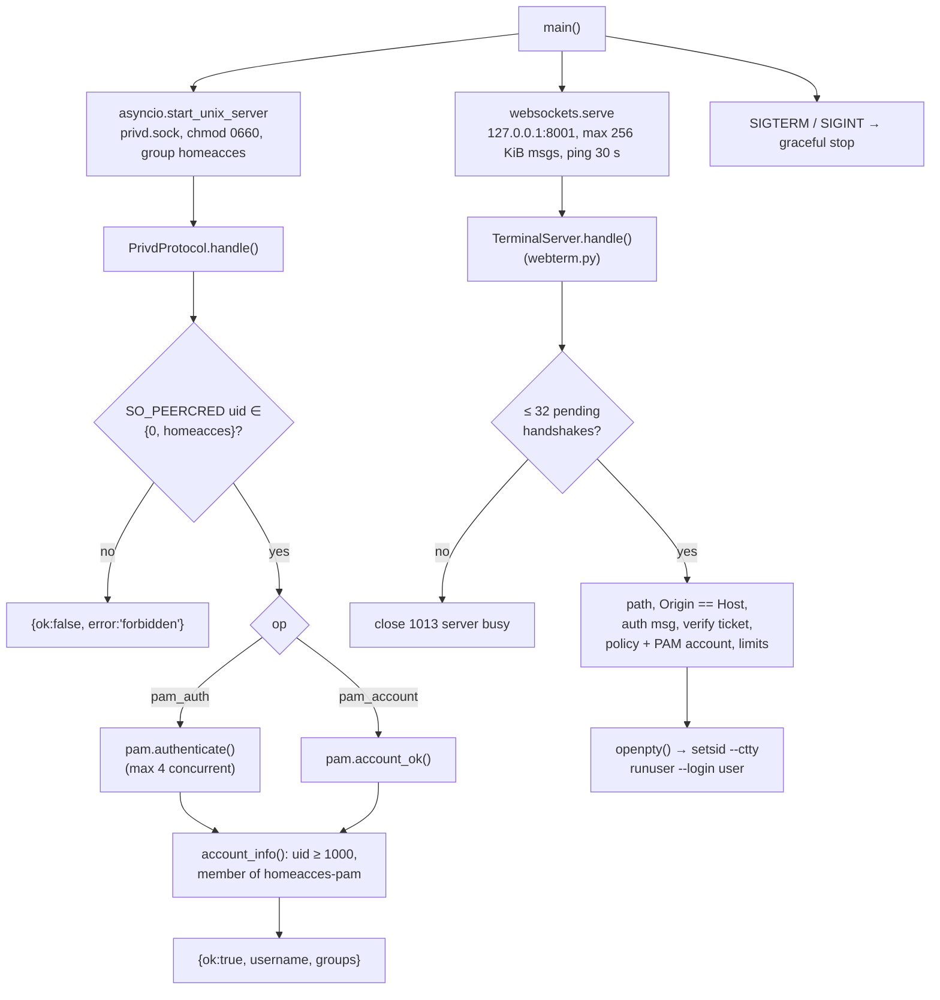
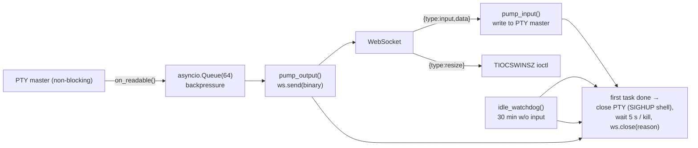
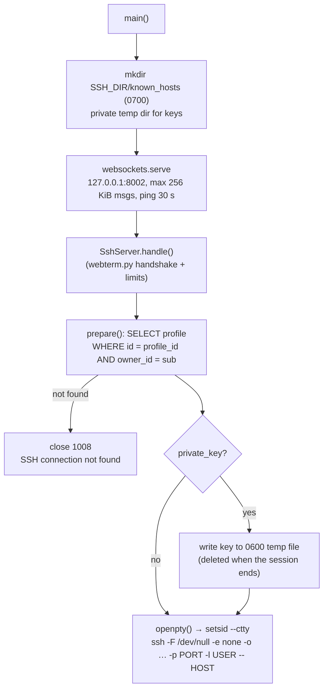

# 2. Backend (Flask API, privileged helper and SSH service)

[← Architecture](01-architecture.md) · [Index](README.md) · Next: [Database →](03-database.md)

The backend lives in `backend/` and consists of three Python packages, plus the module
`webterm.py` (the WebSocket ↔ PTY bridge shared by both terminal services):

| Package | Process | Runs as | Purpose |
|---|---|---|---|
| `app/` | gunicorn → `wsgi:app` | `homeacces` | The REST API (JSON over HTTP) |
| `homeacces_privd/` | `python -m homeacces_privd` | `root` | PAM checks over a Unix socket + web terminal WebSocket |
| `homeacces_ssh/` | `python -m homeacces_ssh` | `homeacces` | SSH terminal WebSocket (OpenSSH client) for the SSH menu |

Dependencies (`backend/requirements.txt`): `Flask`, `PyJWT`, `gunicorn`, `websockets`. Nothing else —
password hashing comes from Werkzeug (bundled with Flask), PAM is called through `ctypes`. The SSH
service runs the system's OpenSSH client (`ssh`, Debian package `openssh-client`).

## 2.1 Module map



| File | Responsibility |
|---|---|
| `app/__init__.py` | Application factory, `ProxyFix`, blueprint registration, `/api/health`, JSON error handler, `Cache-Control: no-store`, CLI commands |
| `app/config.py` | Reads every `HOMEACCES_*` environment variable into the `Config` class |
| `app/db.py` | One SQLite connection per request (`flask.g`), schema creation, in-place migrations |
| `app/schema.sql` | `CREATE TABLE IF NOT EXISTS …` for all static tables |
| `app/auth.py` | Validation, password hashing, JWT issue/verify, cookies, CSRF, `require_auth` decorator, throttling, PAM sync, `/api/auth/*` routes, avatars |
| `app/items.py` | Items CRUD with search, type filter, pagination, ownership checks |
| `app/item_types.py` | Admin-defined item types; creates/alters one SQL table per type |
| `app/users.py` | Admin user management |
| `app/admin.py` | Runtime settings and activity log query |
| `app/activity.py` | Audit trail: DB table + append-only text file, retention pruning |
| `app/settings.py` | Key/value runtime settings with environment defaults |
| `app/terminal.py` | Issues 30-second single-use terminal tickets |
| `app/ssh.py` | SSH menu: each user's saved connections (CRUD, forget host key) and 30-second single-use SSH tickets |
| `app/privd.py` | Sends one JSON line to the helper's Unix socket, returns the reply |
| `homeacces_privd/server.py` | asyncio server: Unix socket protocol + WebSocket terminal (login shells) |
| `homeacces_privd/pam.py` | Minimal Linux-PAM binding (`pam_authenticate`, `pam_acct_mgmt`) |
| `homeacces_ssh/server.py` | asyncio server: WebSocket terminal running the OpenSSH client for one saved connection |
| `webterm.py` | `TerminalServer` base class shared by both terminal services: ticket check, `Origin` check, limits, PTY session |

## 2.2 Application factory and startup

`create_app()` in `app/__init__.py` builds the Flask app. gunicorn imports `wsgi.py`, which calls
it once per worker.



**ProxyFix** trusts exactly one proxy hop (nginx), so `request.remote_addr` is the real client IP
(used for throttling and the activity log) and `request.scheme` reflects HTTPS.

### CLI commands

```bash
flask --app wsgi.py init-db              # create tables / migrate (idempotent)
flask --app wsgi.py create-admin <name>  # create an admin, or promote + reset password
```

`create-admin` refuses names that belong to PAM accounts and records a `user.create` activity entry
with `username="(command line)"`.

## 2.3 Request lifecycle



Conventions used by every view:

- **Input**: `json_body()` requires a JSON object; each field is validated explicitly
  (types, lengths, regexes) and failures call `abort(400, "message")`.
- **Errors**: all `HTTPException`s become `{"error": "<description>", "status": <code>}`.
- **SQL**: always parameterised (`?`). Identifiers that cannot be parameters (item type columns)
  are validated by regex and quoted (see §2.6).
- **Audit**: state-changing views call `activity.record(event, **details)`.
- **Ownership**: items not owned by a non-admin user return **404** (not 403), so ids of other
  users' items are not disclosed. SSH connections are strictly personal: another user's connection
  is a 404 for everyone, admins included.

## 2.4 Configuration (`app/config.py`)

All settings come from environment variables (in production, from `/etc/homeacces/homeacces.env`,
loaded by systemd's `EnvironmentFile=`).

| Variable | Default | Used for |
|---|---|---|
| `HOMEACCES_SECRET_KEY` | — (**required**, ≥ 32 chars) | Signs all JWTs (access, refresh, terminal and SSH tickets) |
| `HOMEACCES_DATABASE` | `backend/instance/homeacces.sqlite3` | SQLite file path |
| `HOMEACCES_ACCESS_TTL_MIN` | `15` | Access token lifetime (minutes) |
| `HOMEACCES_REFRESH_TTL_DAYS` | `7` | Refresh token lifetime (days) |
| `HOMEACCES_COOKIE_SECURE` | `1` | `Secure` flag on cookies (set `0` only for plain-HTTP dev) |
| `HOMEACCES_ALLOW_REGISTRATION` | `0` | Initial value for self-registration (admins can override in UI) |
| `HOMEACCES_ACTIVITY_LOG` | `backend/instance/activity.log` | Activity text file (`""` = DB only) |
| `HOMEACCES_ACTIVITY_RETENTION_DAYS` | `365` | Age after which DB activity rows are pruned (`0` = forever) |
| `HOMEACCES_LOGIN_MAX_FAILURES` | `5` | Failures allowed per IP + method + username… |
| `HOMEACCES_LOGIN_WINDOW_SECONDS` | `900` | …within this window |
| `HOMEACCES_PAM_ENABLED` | `0` (app) / `1` (env template) | Allow system-account login + terminal |
| `HOMEACCES_PAM_ADMIN_GROUP` | `sudo` | PAM users in this group get the web `admin` role |
| `HOMEACCES_PRIVD_SOCKET` | `/run/homeacces/privd.sock` | Helper Unix socket path |
| `HOMEACCES_SSH_ENABLED` | `1` | Initial value for the SSH menu (admins can override in UI) |
| `HOMEACCES_SSH_DIR` | `ssh` next to the database | Holds `known_hosts/<user id>`, one file per user (shared with homeacces-ssh) |

Helper-only variables (read by `homeacces_privd/server.py`): `HOMEACCES_PAM_GROUP` (`homeacces-pam`),
`HOMEACCES_PAM_MIN_UID` (`1000`), `HOMEACCES_PRIVD_CLIENT_USER` (`homeacces`),
`HOMEACCES_TERMINAL_LISTEN` (`127.0.0.1:8001`), `HOMEACCES_TERMINAL_IDLE_MIN` (`30`),
`HOMEACCES_TERMINAL_MAX_PER_USER` (`4`), `HOMEACCES_TERMINAL_MAX_TOTAL` (`16`).

SSH-service-only variables (read by `homeacces_ssh/server.py`, which also reads `HOMEACCES_SECRET_KEY`,
`HOMEACCES_DATABASE`, `HOMEACCES_SSH_DIR` and `HOMEACCES_TERMINAL_IDLE_MIN`):
`HOMEACCES_SSH_LISTEN` (`127.0.0.1:8002`), `HOMEACCES_SSH_MAX_PER_USER` (`4`), `HOMEACCES_SSH_MAX_TOTAL` (`16`).

Fixed values: `JWT_ALGORITHM = "HS256"`, `TERMINAL_TICKET_TTL = 30 s`, `MAX_CONTENT_LENGTH = 64 KiB`,
`REFRESH_REUSE_GRACE_SECONDS = 10`.

## 2.5 API reference

All bodies are JSON. Errors: `{"error": "...", "status": 4xx}`.
Legend: 🌐 public · 🔑 signed in · 👑 admin only · 🖥️ PAM session only.

### Authentication — `auth.py`, prefix `/api/auth`

| Method | Path | Access | Body → Response |
|---|---|---|---|
| GET | `/methods` | 🌐 | → `{local: true, pam, registration}` |
| POST | `/register` | 🌐 (if enabled, off by default) | `{username, password}` → 201 `{user, session}` + cookies; 409 "username already taken" also for system usernames |
| POST | `/login` | 🌐 | `{username, password, method: "local"\|"pam"}` → `{user, session}` + cookies |
| POST | `/token` | 🌐 | same as login → `{access_token, token_type: "Bearer", expires_in}` (no cookies; backed by a session row so it can be revoked) |
| POST | `/refresh` | refresh cookie + CSRF | → `{user, session}` + new cookies |
| POST | `/logout` | 🌐 | → `{ok: true}`, revokes the whole session (its access tokens stop working at once), clears cookies |
| GET | `/me` | 🔑 | → `{user, session: {method}}` |
| PUT | `/password` | 🔑 local only | `{current_password, new_password}` → `{ok}`, other sessions and bearer tokens revoked; 5 wrong current passwords / 15 min → 429 |
| PUT | `/avatar` | 🔑 | `{avatar: "data:image/png;base64,…"}` (60×60 PNG/JPEG, ≤ 32 KB) → `{user}` |
| DELETE | `/avatar` | 🔑 | → `{user}` |

### Items — `items.py`, prefix `/api/items` (🔑; users see their own, admins see all)

| Method | Path | Body / query |
|---|---|---|
| GET | `` | `?q=&type_id=<id>\|none&limit=50 (1–200)&offset=0` → `{items, total, limit, offset}` |
| POST | `` | `{title*, description, done, type_id, fields}` → 201 `{item}` |
| GET | `/<id>` | → `{item}` |
| PUT | `/<id>` | `{title*, description, done, fields}` (type cannot change) → `{item}` |
| DELETE | `/<id>` | → 204 |

Item object: `id, owner_id, owner, title, description, done, type_id, type_name, fields, created_at, updated_at`.

### Item types — `item_types.py`, prefix `/api/item-types` (read 🔑, write 👑)

| Method | Path | Body |
|---|---|---|
| GET | `` | → `{item_types: [{id, name, table, fields:[{id,name,type,default}], item_count, …}]}` |
| GET | `/<id>` | → `{item_type}` |
| POST | `` | `{name, fields: [{name, type, default}]}` → 201 |
| PUT | `/<id>` | `{name, fields}` — fields with `id` are kept/renamed, without `id` are added, missing are dropped |
| DELETE | `/<id>` | → 204, or 409 while items still use it |

### Users — `users.py`, prefix `/api/users` (👑)

| Method | Path | Body |
|---|---|---|
| GET | `` | → `{users: [... , last_login]}` |
| GET | `/<id>` | → `{user}` |
| POST | `` | `{username, password, role}` → 201 |
| PUT | `/<id>` | `{username?, role?, password?}` (local accounts only; cannot demote last admin) |
| DELETE | `/<id>` | → 204 (not yourself; cascades to their items) |

### Admin — `admin.py`, prefix `/api/admin` (👑)

| Method | Path | Body / query |
|---|---|---|
| GET | `/settings` | → `{allow_registration, ssh_enabled, activity_log_file, activity_retention_days}` |
| PUT | `/settings` | `{allow_registration?: bool, ssh_enabled?: bool}` |
| GET | `/activity` | `?user=&event=auth.login\|auth.&result=success\|failure&limit=50 (1–500)&offset=` → `{entries, total, limit, offset, events}` |

### Terminal — `terminal.py` (🖥️) and helper

| Method | Path | Notes |
|---|---|---|
| POST | `/api/terminal/ticket` | → `{ticket, expires_in: 30}`; 404 if PAM disabled, 403 if not a PAM session |
| WS | `/api/terminal/ws` | Served by **homeacces-privd**, not Flask (see §2.9) |

### SSH — `ssh.py`, prefix `/api/ssh` (🔑; every user, own connections only)

| Method | Path | Body → Response |
|---|---|---|
| GET | `/profiles` | → `{profiles: [{id, name, host, port, username, has_key, created_at, updated_at}], enabled}` |
| POST | `/profiles` | `{name, host, port?, username, private_key?}` → 201 `{profile}`; 409 duplicate name; max 100 per user |
| PUT | `/profiles/<id>` | same body → `{profile}`; `private_key` absent = keep, `null`/`""` = remove |
| DELETE | `/profiles/<id>` | → 204 |
| DELETE | `/profiles/<id>/host-key` | → `{removed: n}`: deletes the server's lines (`host` or `[host]:port`) from the user's `known_hosts` |
| POST | `/ticket` | `{profile_id}` → `{ticket, expires_in: 30}`; 403 if an admin disabled SSH, 404 if not your connection |
| WS | `/ws` | Served by **homeacces-ssh**, not Flask (see §2.10) |

Validation (`_validate`) keeps every value safe to put on the `ssh` command line:

| Field | Rule |
|---|---|
| `name` | 1–64 characters, unique per user |
| `host` | IP address (IPv4/IPv6, brackets allowed, no `%zone`) or host name `[A-Za-z0-9_-]` labels, ≤ 253 chars; stored lower-case |
| `port` | integer 1–65535 (default 22) |
| `username` | `^[A-Za-z0-9_][A-Za-z0-9_.@-]{0,63}$` — no leading `-`, no `%` or `$` (OpenSSH expansion) |
| `private_key` | ≤ 16 KB, `-----BEGIN … PRIVATE KEY-----` … `-----END … PRIVATE KEY-----` (OpenSSH or PEM); never returned, only `has_key` |

### Health

`GET /api/health` → `{"status": "ok"}` (also runs `SELECT 1` against SQLite).

## 2.6 Items and item types

An item always has the common columns in `items`. If it has a type, its typed field values live
in a separate table named `item_type_<type id>`, one row per item.



### Lifecycle of a type (admin)



Rules:

- Field types: `int` → `INTEGER`, `float` → `REAL`, `boolean` → `INTEGER` (0/1), `string` → `TEXT` (≤ 5000 chars).
- An existing field may be renamed or get a new default, **never change type**.
- `item_id` is a reserved name. Table names are derived only from the numeric id, column names only
  from regex-validated names, and are additionally double-quoted — this is what makes dynamic DDL safe.
- `_transaction()` explicitly opens `BEGIN IMMEDIATE` because Python's `sqlite3` does not start a
  transaction before DDL on its own.
- Item creation: missing fields get the field default. Item update: missing fields keep their value.
- A type cannot be deleted while items use it (409).

## 2.7 Activity log (`activity.py`)

Every significant action calls `record(event, user=…, success=…, **details)`:



File line format (string values are JSON-quoted so a hostile username cannot forge a line):

```
2026-10-29T21:40:02.118Z event=auth.login result=failure user="alice" ip="192.168.1.20" method="local" client="browser" reason="invalid credentials" ua="Mozilla/5.0 ..."
```

The file is opened in append mode for each event, so multiple gunicorn workers can share it and
logrotate needs no signal.

| Event family | Events |
|---|---|
| `auth.` | `login` (success/failure: `method`, `client`, `reason`), `logout`, `register`, `password_change` (success/failure), `avatar_change`, `token_reuse`, `session_revoked` |
| `user.` | `create`, `update`, `delete` |
| `item.` | `create`, `update`, `delete` |
| `item_type.` | `create`, `update`, `delete` |
| `ssh.` | `profile_create`, `profile_update`, `profile_delete`, `host_key_forget`, `open` (with host, port, remote user; never the key) |
| other | `settings.update`, `terminal.open` |

## 2.8 Runtime settings (`settings.py`)

The `settings` table stores admin-changed values. A missing key falls back to the environment
default (`DEFAULTS = {"allow_registration": "ALLOW_REGISTRATION", "ssh_enabled": "SSH_ENABLED"}`).
So the env file sets the initial behaviour and the Admin → Settings page overrides it permanently.
Switching `ssh_enabled` off stops new SSH tickets; sessions already open are not closed.

## 2.9 The privileged helper (`homeacces_privd`)

A single asyncio process serving two endpoints:



### Unix socket protocol (API → helper)

One JSON line per connection, one JSON line back:

```
→ {"op": "pam_auth", "username": "pi", "password": "…"}
← {"ok": true, "username": "pi", "groups": ["homeacces-pam", "pi", "sudo"]}

→ {"op": "pam_account", "username": "pi"}
← {"ok": false, "error": "denied"}
```

PAM authentication runs **before** the policy check, so response time does not reveal which
accounts exist. If the helper is unreachable, `app/privd.py` returns **503**
"system authentication service unavailable".

### Terminal session internals

The WebSocket side lives in `webterm.py`. Its `TerminalServer` does the handshake (≤ 32 pending
handshakes, path, `Origin`, single-use ticket, per-key and total limits) and runs the session;
subclasses only say which ticket `type` they accept, what the limits count (`session_key()`) and
which command to start (`prepare()`). The helper's subclass accepts `type: "terminal"` tickets,
counts sessions per system user and starts the login shell.



## 2.10 The SSH terminal service (`homeacces_ssh`)

A second `webterm.TerminalServer` subclass, run as the unprivileged `homeacces` user (WebSocket
`127.0.0.1:8002`, path `/api/ssh/ws`). It accepts `type: "ssh"` tickets (claims `sub` + `profile_id`)
and counts sessions per web user (4 per user, 16 in total by default).



`ssh` gets the PTY as its controlling terminal, so it asks for passwords, key passphrases and
unknown host keys inside the browser terminal. `ssh_command()` builds a fixed, locked-down command line:

| Option | Why |
|---|---|
| `-F /dev/null` | Ignore any `ssh_config` |
| `-e none` | No escape character, so no `~C` command line |
| `UserKnownHostsFile=SSH_DIR/known_hosts/<user id>`, `GlobalKnownHostsFile=none` | One host-key list per web user |
| `StrictHostKeyChecking=ask` | New keys are confirmed in the terminal; changed keys are refused |
| `IdentitiesOnly=yes`, `IdentityAgent=none`, `IdentityFile=<temp file>\|none` | Only the connection's own key, never an agent |
| `ClearAllForwardings=yes`, `ForwardAgent=no`, `ForwardX11=no` | No port, agent or X11 forwarding |
| `PermitLocalCommand=no`, `ControlMaster=no`, `ControlPath=none` | No local commands, no shared connections |
| `ConnectTimeout=15`, `ServerAliveInterval=30` | Fail fast, detect dead servers |

The destination comes after `--`, and host and user were validated by the API (§2.5), so they can
never be read as options.

## 2.11 Tests

`backend/tests/` (pytest, 60 tests) covers: health, register/login/logout, validation, CSRF,
items CRUD and isolation, bearer tokens, refresh rotation, reuse detection and the grace period,
instant revocation of access and bearer tokens, login and password-change throttling,
password change, user admin, registration toggle, activity log, PAM login/refresh/role sync
(with a fake helper), terminal tickets, schema migration, avatars, item types, the helper's
socket protocol, terminal sessions and handshake limit, and the SSH menu (`test_ssh.py` and
`test_api.py`): profile CRUD, validation, privacy, tickets, the admin switch, forgetting host keys,
the locked-down `ssh` command line (also checked against the real OpenSSH client) and SSH sessions in a PTY.

```bash
cd backend && .venv/bin/python -m pytest
```

## 2.12 Extending the API

To add a new resource:

1. Copy `app/items.py` → new blueprint, protect views with `@require_auth()` (or `@require_auth(("admin",))`).
2. Add its table to `app/schema.sql` (and a step in `db._migrate()` if existing databases need a new column).
3. Register the blueprint in `create_app()`.
4. Call `record("<resource>.<action>", …)` on changes.
5. Add a page in `frontend/src/pages/` and a route in `App.jsx`.
