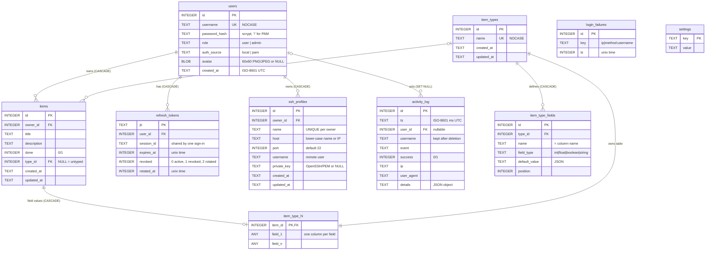
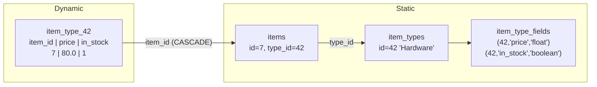
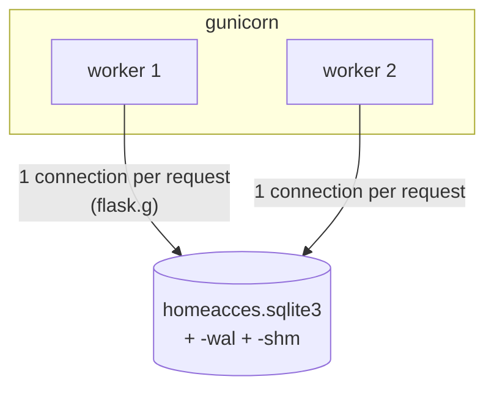
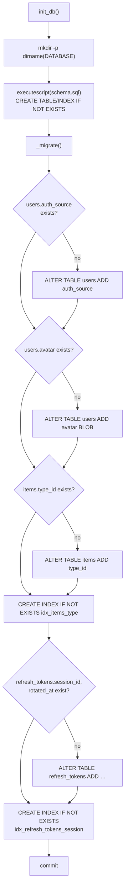

# 3. Database (SQLite)

[← Backend](02-backend.md) · [Index](README.md) · Next: [Authentication →](04-authentication.md)

HomeAcces stores everything in a single SQLite file:

| Environment | Path |
|---|---|
| Server | `/var/lib/homeacces/homeacces.sqlite3` (owner `homeacces`, dir mode 0750) |
| Dev / local | `backend/instance/homeacces.sqlite3` |

SQLite fits the target well: no server process, tiny memory footprint, a single file to back up.
The schema is in `backend/app/schema.sql`; table creation and migrations are in `backend/app/db.py`.
The SSH host keys users have accepted are not in the database but in one `known_hosts` file per
user under `HOMEACCES_SSH_DIR` (default `ssh/` next to the database, see §3.2 `ssh_profiles`).

## 3.1 Entity-relationship diagram



`item_type_N` stands for the dynamic tables `item_type_1`, `item_type_2`, … — one per item type
(see §3.3). `login_failures` and `settings` have no relations.

## 3.2 Tables

### `users`

| Column | Notes |
|---|---|
| `username` | `UNIQUE COLLATE NOCASE` → `Alice` and `alice` are the same account |
| `password_hash` | Werkzeug `scrypt` hash for local accounts; `'!'` (never matches) for PAM accounts |
| `role` | `CHECK (role IN ('user','admin'))` |
| `auth_source` | `'local'` (password here) or `'pam'` (row mirrors a system account; recreated at each login if deleted) |
| `avatar` | Raw image bytes, validated to be a 60×60 PNG or JPEG ≤ 32 KB; served as a `data:` URL |

### `refresh_tokens`

One row per issued refresh JWT, keyed by its `jti`. All rows of one sign-in share a `session_id`,
which access tokens carry as the `sid` claim; `require_auth` accepts an access token only while
its session has an active row, so revoking a session ends its access tokens immediately.

| `revoked` | Meaning |
|---|---|
| `0` | Active |
| `2` | Rotated: replaced by a newer token at `rotated_at`. Presented again within 10 s (another tab refreshing at the same time), it is still accepted |
| `1` | Revoked (logout, password change, theft detection). Presenting it — or a rotated token after the grace period — revokes **all** rows of the user |

Rotation is a single conditional `UPDATE … WHERE jti = ? AND revoked = 0`, so of two concurrent
requests (in any gunicorn worker) exactly one rotates the token. `POST /api/auth/token` also
creates a row (never sent to the client) so bearer tokens can be revoked. Expired rows are
deleted opportunistically on failed logins.

### `login_failures`

Sliding-window brute-force counter shared by all gunicorn workers. Key formats:
`<client ip>|<method>:<username>` (lower-cased) for logins, `pwchange:<user id>` for wrong
current passwords on password change. Rows older than the window are deleted
whenever a new failure is recorded; a successful login clears the key.

### `items`

Common data for every item. `owner_id → users.id ON DELETE CASCADE` (deleting a user deletes
their items). `type_id → item_types.id` (no cascade: a type in use cannot be deleted).
Indexes: `idx_items_owner`, `idx_items_type`.

### `item_types` and `item_type_fields`

The catalogue of user-defined types. `item_type_fields.name` is both the field name in the API and
the column name in the type's table. `default_value` is stored as JSON (`0`, `1.5`, `true`, `"text"`).
`position` keeps the field order chosen in the UI. `UNIQUE (type_id, name)`.

### `ssh_profiles`

Each user's saved SSH connections (SSH menu), read by the API and by `homeacces-ssh` when a session
opens. `owner_id → users.id ON DELETE CASCADE`; `UNIQUE (owner_id, name)`. Rows are private to their
owner: every query filters on `owner_id`, for admins too.

| Column | Notes |
|---|---|
| `host`, `port`, `username` | Validated by `app/ssh.py` so they are safe on the `ssh` command line (see [Backend §2.5](02-backend.md#25-api-reference)) |
| `private_key` | Optional OpenSSH/PEM private key (≤ 16 KB), **stored as is, not encrypted**, never sent back to the browser (the API returns `has_key`). `NULL` = password or keyboard-interactive login. Passwords are never stored |

Host keys accepted in the terminal live in `HOMEACCES_SSH_DIR/known_hosts/<user id>` (written by
`ssh`, owned by `homeacces`, directory mode 0700). Deleting a user deletes their profiles (cascade)
and their `known_hosts` file.

### `settings`

Key/value store for admin-changed runtime settings: `allow_registration` and `ssh_enabled` (`'0'`/`'1'`).

### `activity_log`

Audit trail. `user_id` uses `ON DELETE SET NULL`, while `username` is copied so entries remain
readable after the user is deleted. Indexes on `ts`, `user_id`, `event`.

## 3.3 Dynamic per-type tables

When an admin creates item type **42** with fields `price: float` and `in_stock: boolean`, the API
executes (inside one transaction):

```sql
INSERT INTO item_types (name) VALUES ('Hardware');               -- → id 42
CREATE TABLE item_type_42 (
    item_id INTEGER PRIMARY KEY REFERENCES items(id) ON DELETE CASCADE,
    "price"    REAL,
    "in_stock" INTEGER
) STRICT;
INSERT INTO item_type_fields (type_id, name, field_type, default_value, position)
VALUES (42, 'price', 'float', '0.0', 0), (42, 'in_stock', 'boolean', 'false', 1);
```



Why one table per type? Values keep real SQL types (`STRICT` tables reject wrong types), rows are
compact, and dropping a field is a plain `ALTER TABLE … DROP COLUMN`. The cost is that DDL runs at
runtime, which is why identifiers are strictly validated (see [Backend §2.6](02-backend.md#26-items-and-item-types)).

| Schema change in the UI | SQL executed on `item_type_<id>` |
|---|---|
| Add field | `ALTER TABLE … ADD COLUMN "f" TYPE` + `UPDATE … SET "f" = <default>` |
| Remove field | `ALTER TABLE … DROP COLUMN "f"` (data lost) |
| Rename field | `RENAME COLUMN "a" TO "_tmp_<fid>"`, then `"_tmp_<fid>" TO "b"` |
| Delete type | `DROP TABLE item_type_<id>` (only when no item uses it) |

## 3.4 Connections and concurrency



Each request opens one connection (`db.get_db()`), stored in `flask.g`, and closes it at
teardown. `homeacces-ssh` also opens a short connection each time an SSH session starts, to read
the profile (read-only). Every connection sets:

| Setting | Why |
|---|---|
| `PRAGMA journal_mode = WAL` (in schema) | Readers don't block the writer; persistent for the file |
| `PRAGMA foreign_keys = ON` | Enforces the `REFERENCES … ON DELETE` rules (off by default in SQLite) |
| `PRAGMA busy_timeout = 5000` + `timeout=10` | Wait for a lock instead of failing immediately |
| `row_factory = sqlite3.Row` | Rows accessible by column name |

WAL mode creates two companion files next to the database (`-wal`, `-shm`); the directory must
be writable by `homeacces` — which is why systemd grants `ReadWritePaths=/var/lib/homeacces`.

## 3.5 Schema creation and migrations

`init_db()` runs on every app start (and via `flask init-db`):



Everything is idempotent, so upgrading is just: deploy new code → restart. When you add a column
to an existing table, add both the column in `schema.sql` (for new databases) **and** a check in
`_migrate()` (for existing ones).

## 3.6 Maintenance

```bash
# Open the database (read-only queries are safe while the service runs)
sudo -u homeacces sqlite3 /var/lib/homeacces/homeacces.sqlite3

# Useful queries
SELECT id, username, role, auth_source, created_at FROM users;
SELECT event, COUNT(*) FROM activity_log GROUP BY event;
SELECT p.id, u.username, p.name, p.username || '@' || p.host || ':' || p.port, p.private_key IS NOT NULL AS has_key
  FROM ssh_profiles p JOIN users u ON u.id = p.owner_id;
SELECT ts, username, ip FROM activity_log WHERE event='auth.login' AND success=0 ORDER BY id DESC LIMIT 20;
.tables            -- also shows item_type_<id> tables

# Online backup (consistent even with WAL and running service)
sudo sqlite3 /var/lib/homeacces/homeacces.sqlite3 ".backup /root/homeacces-$(date +%F).sqlite3"

# Restore
sudo systemctl stop homeacces homeacces-ssh
sudo install -o homeacces -g homeacces -m 0640 /root/homeacces-2026-10-29.sqlite3 /var/lib/homeacces/homeacces.sqlite3
sudo rm -f /var/lib/homeacces/homeacces.sqlite3-wal /var/lib/homeacces/homeacces.sqlite3-shm
sudo systemctl start homeacces homeacces-ssh
```

The database backup contains the saved SSH private keys: keep it private. To keep the users'
accepted host keys as well, back up `/var/lib/homeacces/ssh/` too.

Do not copy the `.sqlite3` file with `cp` while the service runs — use `.backup`, which takes a
consistent snapshot including uncommitted WAL pages.
