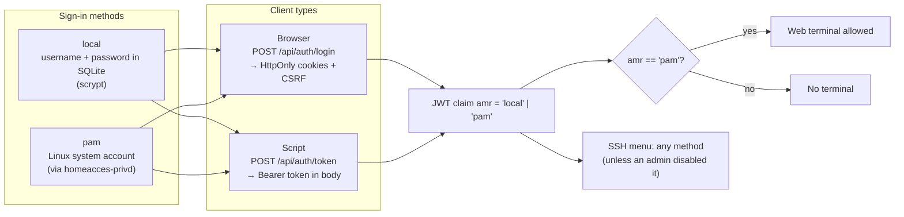
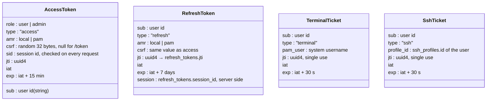
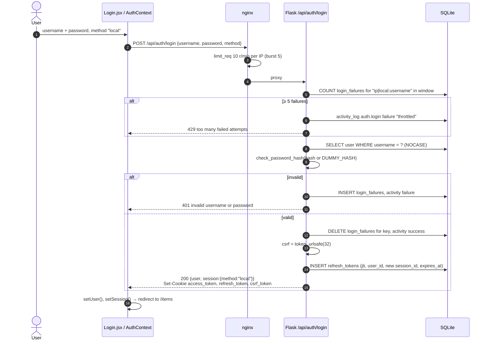
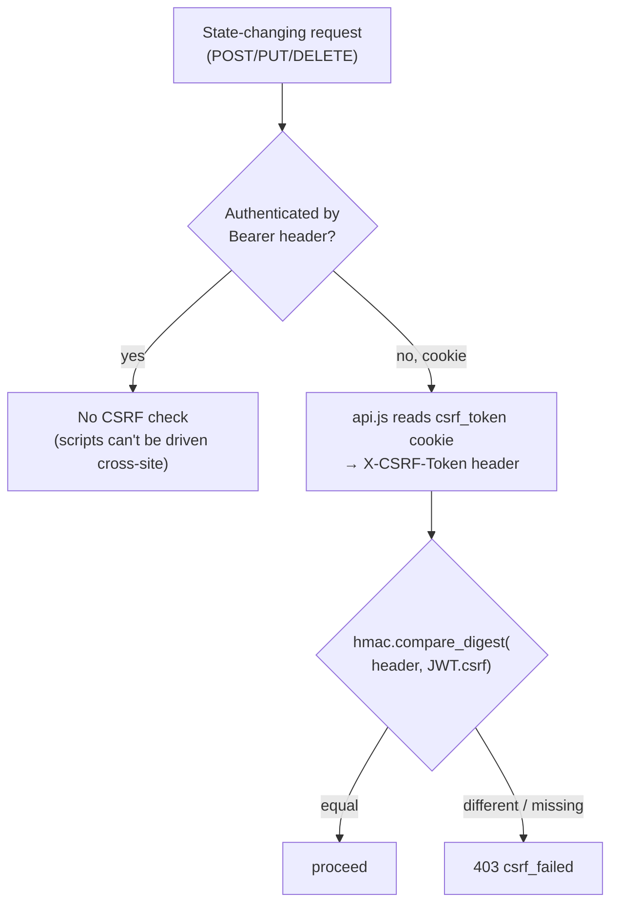
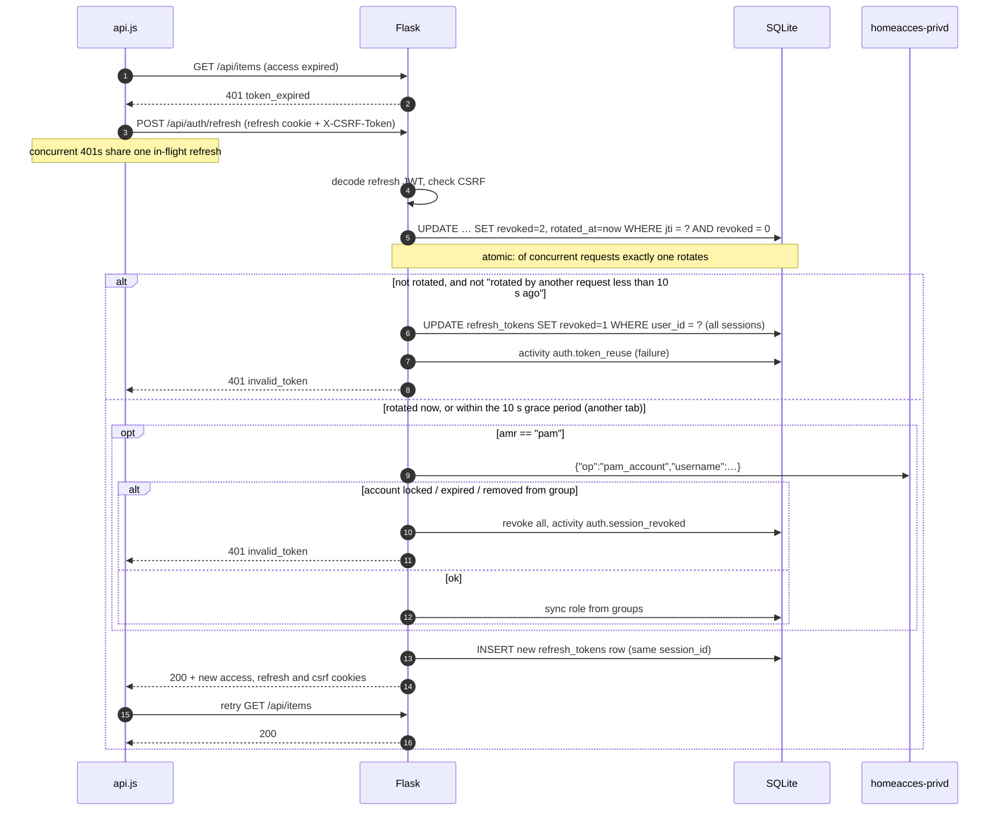
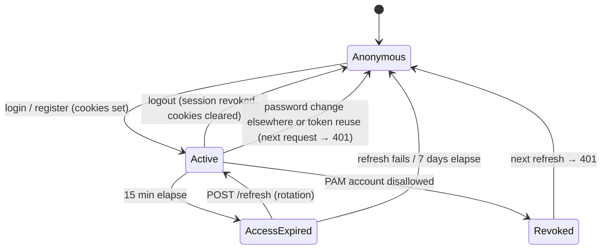
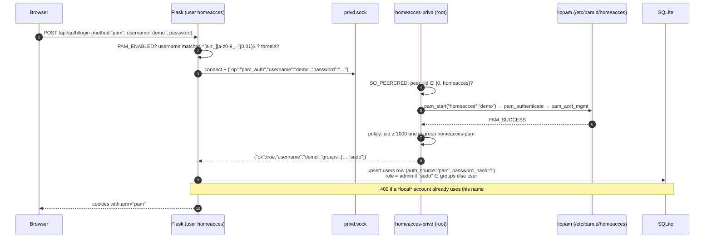
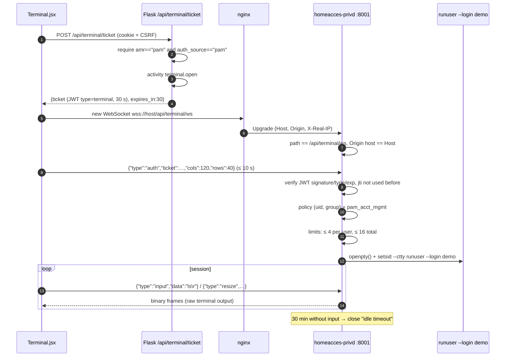
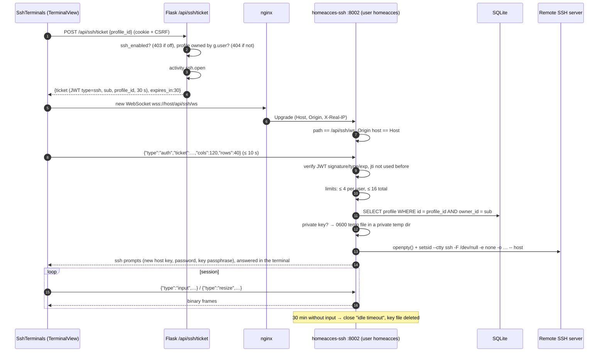
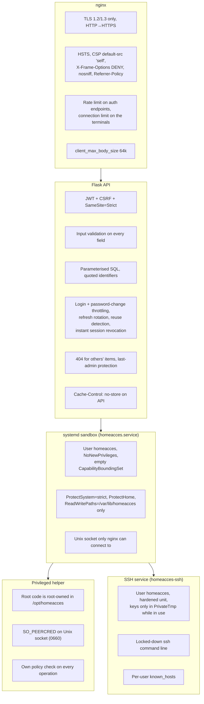

# 4. Authentication and security

[← Database](03-database.md) · [Index](README.md) · Next: [Frontend →](05-frontend.md)

Code: `backend/app/auth.py`, `backend/app/terminal.py`, `backend/app/ssh.py`, `backend/app/privd.py`,
`backend/homeacces_privd/`, `backend/homeacces_ssh/`, `backend/webterm.py`, `frontend/src/api.js`,
`frontend/src/AuthContext.jsx`.

## 4.1 Overview



| Concept | Implementation |
|---|---|
| Password storage | Werkzeug `generate_password_hash` (scrypt); constant-time dummy check for unknown users |
| Session tokens | JWT HS256 signed with `HOMEACCES_SECRET_KEY` |
| Access token | 15 min, cookie `access_token` (HttpOnly, path `/`) or `Authorization: Bearer` |
| Refresh token | 7 days, cookie `refresh_token` (HttpOnly, path `/api/auth` only), stored in DB by `jti` |
| Session | All tokens of one sign-in share a `session_id` (access tokens carry it as `sid`); revoking it ends the access tokens immediately |
| CSRF | Double-submit token **bound into the JWT**: readable cookie `csrf_token` must be echoed in `X-CSRF-Token` and match the `csrf` claim |
| Cookie flags | `HttpOnly` (except CSRF), `Secure`, `SameSite=Strict` |
| Brute force | App: 5 failures / 15 min per IP+method+username → 429, and 5 wrong current passwords / 15 min per account on password change. nginx: 10 req/min per IP on login/register/token/password |
| Roles | `user`, `admin` — checked by `require_auth(roles)` on every request from the DB row (not from the token) |

## 4.2 Tokens



Decoding (`_decode`) requires `exp, iat, sub, type, jti`, checks the expected `type` (an access
token cannot be used as a refresh token and vice versa) and that `amr` is `local` or `pam`.
Errors give `401 token_expired` or `401 invalid_token`.

The **role in the token is informational only**: `require_auth` reloads the user row on every
request, so a demotion or deletion takes effect immediately. It also checks that the token's
session (`sid`) still has an active row in `refresh_tokens`, so logout and revocation take effect
immediately too.

## 4.3 Local login (browser)



Cookies set on success:

| Cookie | HttpOnly | Path | Max-Age | Content |
|---|---|---|---|---|
| `access_token` | ✅ | `/` | 15 min | access JWT |
| `refresh_token` | ✅ | `/api/auth` | 7 days | refresh JWT |
| `csrf_token` | ❌ (JS must read it) | `/` | 7 days | same random value as the `csrf` claim |

All three are `Secure` and `SameSite=Strict`.

## 4.4 CSRF protection



Because the expected value lives **inside the signed JWT**, an attacker who manages to plant a
`csrf_token` cookie (e.g. from a sibling subdomain) still cannot pass the check. `SameSite=Strict`
is a second, independent layer.

## 4.5 Token refresh and rotation



If refresh fails, `api.js` dispatches a `session-expired` window event; `AuthContext` clears the
user and the router sends the user to `/login`.

### Session states



Logout, a password change and token-reuse detection revoke sessions in the database, and
`require_auth` rejects access tokens of revoked sessions at once. Bearer tokens from
`/api/auth/token` are backed by a session row too, so a password change ends them as well.
Two cases still wait for the next refresh (≤ 15 min): a system account that was locked or
removed from `homeacces-pam`, and a terminal or SSH session that is already open (it stays open
until it is closed or idle).

## 4.6 PAM (system account) login



Safeguards:

- Only members of **`homeacces-pam`** with **uid ≥ 1000** can sign in; `root` and daemons never can.
- The policy is re-checked on **every refresh** (every 15 min) and **every terminal start**, so
  `gpasswd -d <user> homeacces-pam` or `usermod -L <user>` ends web access quickly.
- New local accounts cannot be registered under an existing system username (`pwd.getpwnam`),
  and a PAM login cannot take over a local account with the same name. Self-registration answers
  "username already taken" for system usernames, so it cannot be used to list the server's accounts
  (only admins creating users see "reserved for a system account"). Self-registration is off by default.
- PAM users in `HOMEACCES_PAM_ADMIN_GROUP` (default `sudo`) become web admins — they can already
  become root, so nothing new is granted.
- PAM users cannot change their password, name or role in the web UI: the system is authoritative.

## 4.7 Web terminal authentication

The WebSocket cannot carry the CSRF header and is handled by a different process, so it uses a
**ticket**:



| Threat | Mitigation |
|---|---|
| Cross-site WebSocket hijacking | Ticket comes from a CSRF-protected POST; `Origin` must equal `Host` |
| Ticket replay | `jti` remembered until expiry; 30 s lifetime |
| Local account named like a system user | Requires `amr == "pam"` **and** `auth_source == "pam"` |
| Removed / locked system user | Policy + `pam_acct_mgmt` on every terminal start |
| Resource exhaustion | Per-user (4) and global (16) session limits, max 32 unauthenticated handshakes, nginx max 8 connections per IP, 256 KiB message cap, output backpressure, idle timeout |

## 4.8 SSH menu authentication and security

The SSH terminal uses the same ticket scheme (`webterm.py` is shared), with a ticket of
`type: "ssh"` naming one of the user's saved connections. Any signed-in user may get one, whatever
the sign-in method, unless an admin switched the SSH menu off.



| Threat | Mitigation |
|---|---|
| Cross-site WebSocket hijacking, ticket replay | Same as the local terminal: CSRF-protected ticket POST, `Origin` == `Host`, single-use `jti`, 30 s lifetime |
| Using someone else's connection | Profiles are filtered by `owner_id` in the API **and** again in homeacces-ssh against the ticket's `sub`; admins cannot see others' profiles either |
| Escaping from SSH to the server | `ssh` runs as the unprivileged `homeacces` user in a hardened unit (`ProtectSystem=strict`, `ProtectHome`, `PrivateTmp`, `NoNewPrivileges`, no capabilities); no `ssh_config`, no escape character, no forwardings, no `LocalCommand`, no agent, no connection sharing |
| Option injection through host / user | Strict validation (no leading `-`, no `%`/`$`, no spaces), destination after `--` |
| Trusting another user's servers / MITM | One `known_hosts` file per web user, no global file; new keys are confirmed by the user, changed keys are refused until the user forgets the old one ("Forget host key") |
| Password theft from the database | Passwords and passphrases are never stored, only typed in the terminal |
| Resource exhaustion | Per-user (4) and global (16) session limits, max 32 unauthenticated handshakes, shared nginx limit of 8 terminal connections per IP, idle timeout |

**Saved private keys** are stored unencrypted in `ssh_profiles.private_key`, and while a session runs
also in a 0600 temp file in the service's private `/tmp`. Anyone who can read the database (root,
the `homeacces` user, database backups) can read them. They are never sent back to the browser.
Users should save only keys protected by a passphrase (`ssh` asks for it in the terminal).

The SSH client connects **from the server**, so users can reach any host the server can reach (including
the local network). Admins can switch the SSH menu off in Admin → Settings (new tickets are refused;
open sessions continue until closed or idle), or remove the feature with
`sudo systemctl disable --now homeacces-ssh`.

## 4.9 Bearer tokens for scripts

```bash
TOKEN=$(curl -sk https://server.local/api/auth/token -H 'Content-Type: application/json' \
  -d '{"username":"admin","password":"..."}' | python3 -c 'import sys,json;print(json.load(sys.stdin)["access_token"])')
curl -sk https://server.local/api/items -H "Authorization: Bearer $TOKEN"
```

`/api/auth/token` returns only an access token (no refresh token); request a new one after
`expires_in` seconds. No CSRF header is needed for Bearer requests. A password change or
"revoke all" (token reuse) invalidates bearer tokens immediately.

## 4.10 Defence in depth



The CSP allows `style-src 'unsafe-inline'` because xterm.js sets inline styles; **scripts remain
`'self'` only**. `connect-src` permits `wss://<host>` for the terminals.

To disable the PAM/terminal feature entirely: set `HOMEACCES_PAM_ENABLED=0` and run
`sudo systemctl disable --now homeacces-privd`. To disable the SSH menu: switch it off in Admin →
Settings (or `HOMEACCES_SSH_ENABLED=0` before an admin changed it) and run
`sudo systemctl disable --now homeacces-ssh`.
