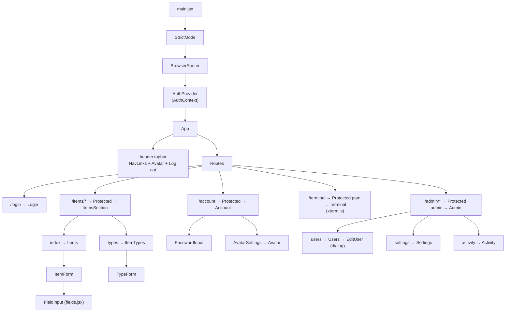
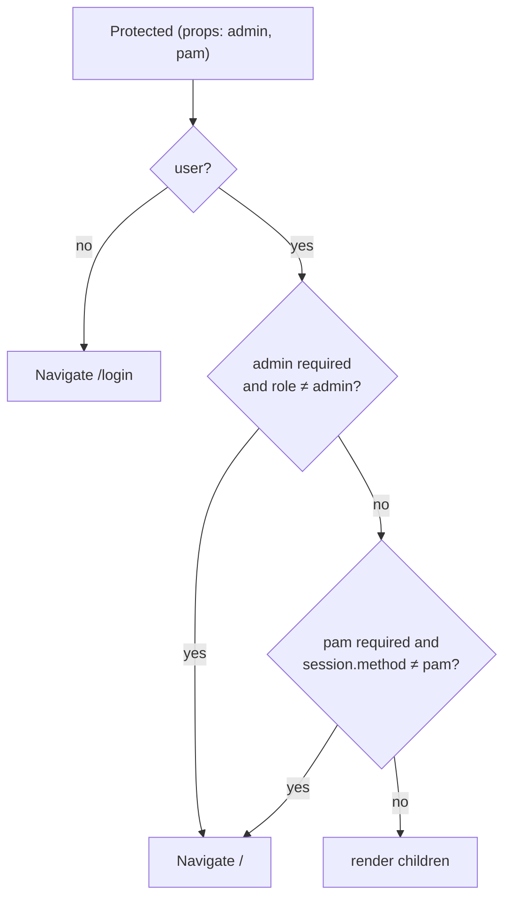
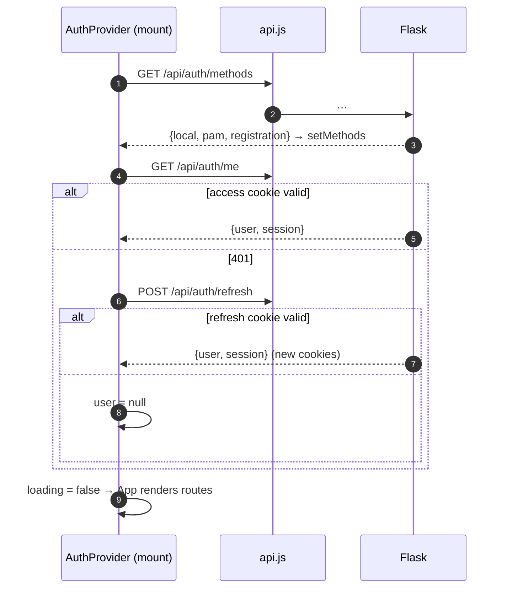
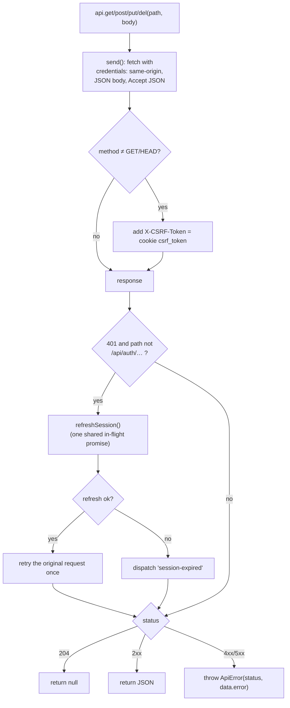
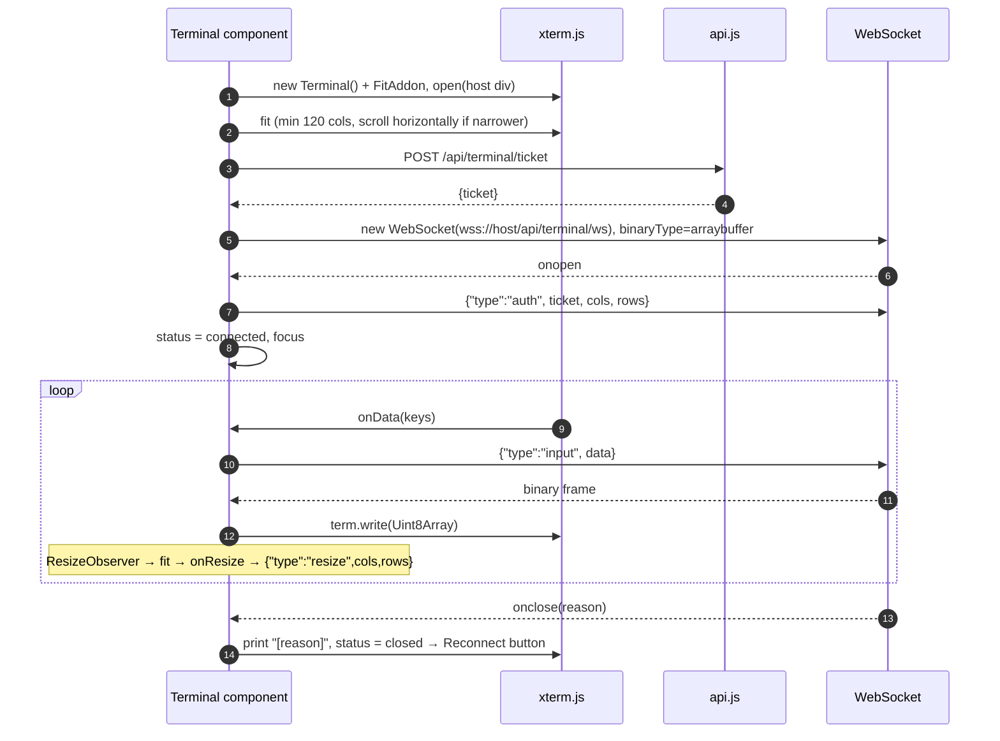
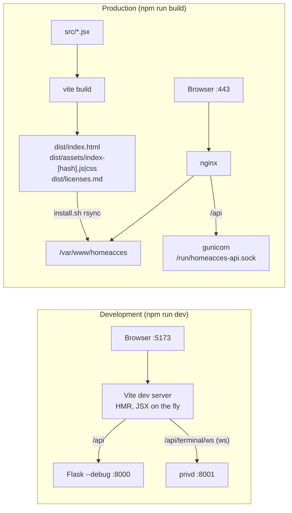

# 5. Frontend (React single-page application)

[← Authentication](04-authentication.md) · [Index](README.md) · Next: [Deployment →](06-deployment.md)

The UI lives in `frontend/`. It is a **React 18** single-page application built with **Vite**.
In production, the build output (`frontend/dist/`) is plain static files served by nginx from
`/var/www/homeacces`; there is no Node.js process on the Pi at runtime.

| Dependency | Use |
|---|---|
| `react`, `react-dom` 18.3.1 | UI rendering |
| `react-router-dom` 6.30.6 | Client-side routing (`BrowserRouter`) |
| `@xterm/xterm` 5.5.0, `@xterm/addon-fit` 0.10.0 | Web terminal emulator |
| `vite` 8.3.5, `@vitejs/plugin-react` 6.1.2 | Dev server with hot reload, production bundler (needs Node.js ≥ 20.19; Debian 13 ships 20.19.2) |

No UI framework and no state library: one global stylesheet (`src/styles.css`) and one React
context for authentication.

## 5.1 File structure

```
frontend/
├── index.html               <div id="root"> + <script type="module" src="/src/main.jsx">
├── vite.config.js           dev proxy /api → :8000, /api/terminal/ws → :8001; build writes dist/licenses.md
├── package.json
└── src/
    ├── main.jsx             mounts <StrictMode><BrowserRouter><AuthProvider><App/>
    ├── App.jsx              top bar + routes + <Protected> guard
    ├── AuthContext.jsx      user / session / methods state, login/register/logout
    ├── api.js               fetch wrapper: cookies, CSRF header, auto-refresh, ApiError
    ├── styles.css           all styles
    ├── Avatar.jsx            with default silhouette
    ├── AvatarSettings.jsx   upload → crop/resize to 60×60 in a <canvas>
    ├── PasswordInput.jsx    password field with show/hide button
    └── pages/
        ├── Login.jsx        sign in (local / system account) and register
        ├── Account.jsx      password change + avatar
        ├── Terminal.jsx     xterm.js ↔ WebSocket
        ├── items/
        │   ├── ItemsSection.jsx   tabs: Items | Item types
        │   ├── Items.jsx          list, search, filter, pagination, create/edit
        │   ├── ItemTypes.jsx      type editor (admins edit, others read)
        │   └── fields.jsx         typed field inputs and conversions
        └── admin/
            ├── Admin.jsx          tabs: Users | Settings | Activity log
            ├── Users.jsx          user table, create, edit dialog, delete
            ├── Settings.jsx       registration on/off
            └── Activity.jsx       filtered, paginated activity log
```

## 5.2 Component tree



## 5.3 Routing and guards

| Path | Component | Guard | Shown in nav when |
|---|---|---|---|
| `/login` | `Login` | redirects to `/` if already signed in | — |
| `/` | → `/items` | | |
| `/items` | `Items` | signed in | always |
| `/items/types` | `ItemTypes` | signed in | (tab) |
| `/account` | `Account` | signed in | always (avatar + name) |
| `/terminal` | `Terminal` | signed in **with PAM** | `session.method === 'pam'` |
| `/admin/users`, `/admin/settings`, `/admin/activity` | `Users`, `Settings`, `Activity` | `role === 'admin'` | admin |
| `/users` | → `/admin/users` | | legacy link |
| `*` | → `/` | | |



These guards are for **user experience only**. Every permission is enforced again by the API
(`require_auth`), so hiding a link is never the only protection.

Because the app uses `BrowserRouter` (real paths, not `#/`), nginx must return `index.html` for
unknown paths — that is the `try_files $uri /index.html` rule.

## 5.4 Authentication state (`AuthContext.jsx`)



The context exposes:

| Value | Meaning |
|---|---|
| `user` | `{id, username, role, auth_source, created_at, avatar}` or `null` |
| `session` | `{method: 'local' \| 'pam'}` — how *this* session signed in |
| `methods` | `{local, pam, registration}` — what the login page should offer |
| `loading` | `true` until the initial session check finishes (App shows "Loading…") |
| `login(u, p, method)`, `register(u, p)`, `logout()` | call the API and update state |
| `reloadUser()` | re-fetch `/me` (after avatar change or self-rename) |

It also listens for the `session-expired` window event (emitted by `api.js`) to drop the user.

## 5.5 API client (`api.js`)



Pages catch `ApiError` and display `err.message`, which is the server's `error` text
(e.g. "username already taken").

## 5.6 Pages

### Login (`pages/Login.jsx`)

```
┌──────────── Sign in ────────────┐
│ [HomeAcces account|System account]  ← only if methods.pam
│ Username  [______________]      │
│ Password  [__________] (👁)     │
│ [ Sign in ]                     │
│ No account? Register            │  ← only if methods.registration (off by default)
└─────────────────────────────────┘
```

Switches between *login* and *register* modes; registration always creates a local account.

### Items (`pages/items/Items.jsx`)

- Loads `/api/item-types` once and `/api/items?limit=20&offset=…&q=…&type_id=…` on every change.
- Search box (title/description), type filter (all / no type / a specific type), pagination (20 per page).
- `ItemForm` for create and edit: choosing a type renders one `FieldInput` per field.
  The type can only be chosen at creation.
- `fields.jsx` converts between API values and form values (numbers are edited as text and
  converted with `toJson`; invalid numbers become `null` and are rejected by the server).

### Item types (`pages/items/ItemTypes.jsx`)

Everyone can see the list; admins get the `TypeForm` to add/edit/delete types. Existing fields
are sent back with their `id` so the server keeps their data; removing a row in the form drops
that column.

### Account (`pages/Account.jsx`)

Local accounts: change password (other sessions are signed out; after 5 wrong current passwords
the API answers 429 for 15 minutes). PAM accounts: an explanation
that the password is changed with `passwd`. Both: `AvatarSettings` — the image is cropped to a
centred square and scaled to 60×60 **in the browser** (`<canvas>`), then sent as a data URL.

### Admin (`pages/admin/*`)

| Tab | Calls | Features |
|---|---|---|
| Users | `GET/POST /api/users`, `PUT/DELETE /api/users/<id>` | Table with avatar, role, source, last login; create form; `<dialog>` editor (local accounts only); delete with confirmation |
| Settings | `GET/PUT /api/admin/settings` | Toggle self-registration; shows log file and retention |
| Activity log | `GET /api/admin/activity` | Filters user / event (exact or `prefix.`) / result; 50 per page, Newer / Older |

## 5.7 Web terminal (`pages/Terminal.jsx`)



The `useEffect` depends on a `session` counter: clicking **Reconnect** increments it, which
disposes the old terminal and socket and builds new ones. Cleanup on unmount closes the socket
(the helper then hangs up the shell).

## 5.8 Development vs production



Same origin in both cases (the dev server proxies `/api`), so cookies, `SameSite=Strict` and the
CSRF flow behave identically. In dev, `HOMEACCES_COOKIE_SECURE=0` because Vite serves plain HTTP.

```bash
cd frontend
npm install
npm run dev       # http://localhost:5173 (needs the API on :8000)
npm run build     # → dist/
npm run preview   # serve dist/ locally
```

The minifier removes license comments from the bundle, so the build writes the licenses of all
bundled dependencies (React, React Router, xterm.js, …) to `dist/licenses.md` instead
(`build.license` in `vite.config.js`). nginx serves it at `/licenses.md`.

## 5.9 Adding a page

1. Create `src/pages/MyPage.jsx`; call the API with `api.get/post/put/del` and show `err.message` on failure.
2. Add `<Route path="/mypage" element={<Protected><MyPage /></Protected>} />` in `App.jsx`
   (use `admin` or `pam` props if needed) and a `<NavLink>` in the top bar.
3. Add styles to `styles.css`. Avoid inline `<script>` or external resources — the CSP only
   allows same-origin scripts, styles, images (plus `data:` images) and connections.
