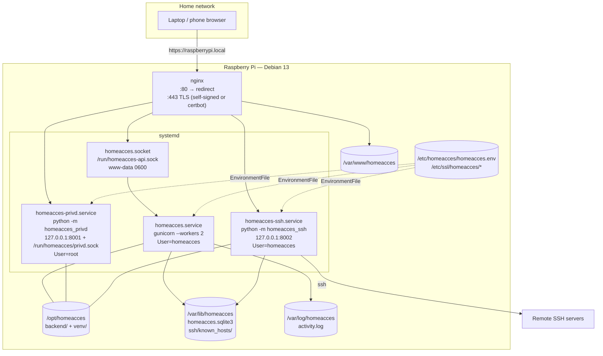
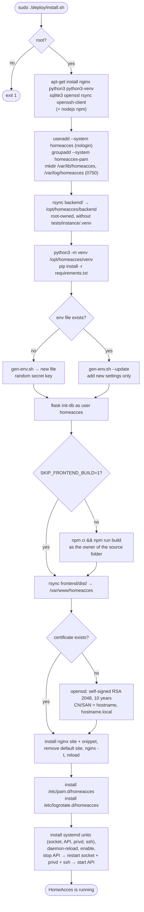
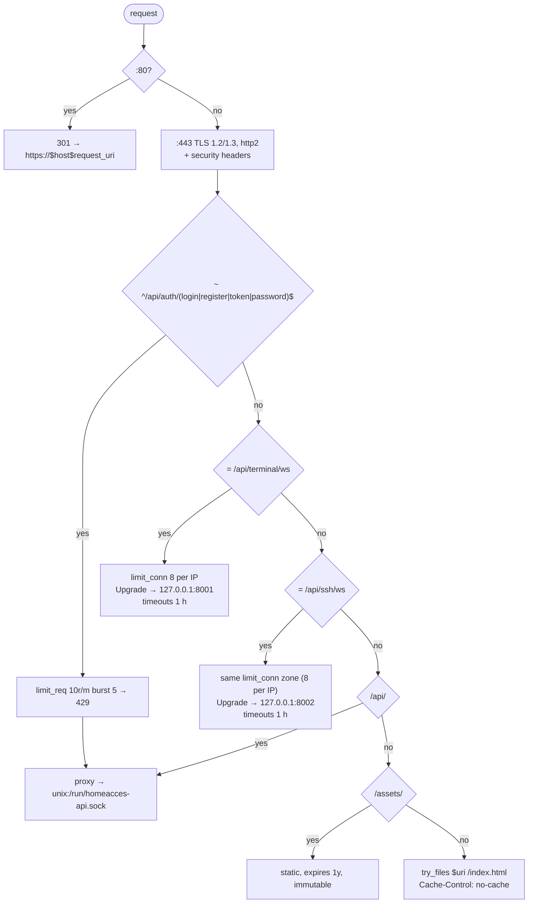
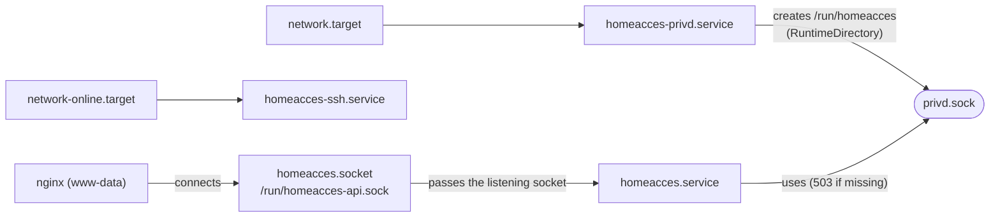
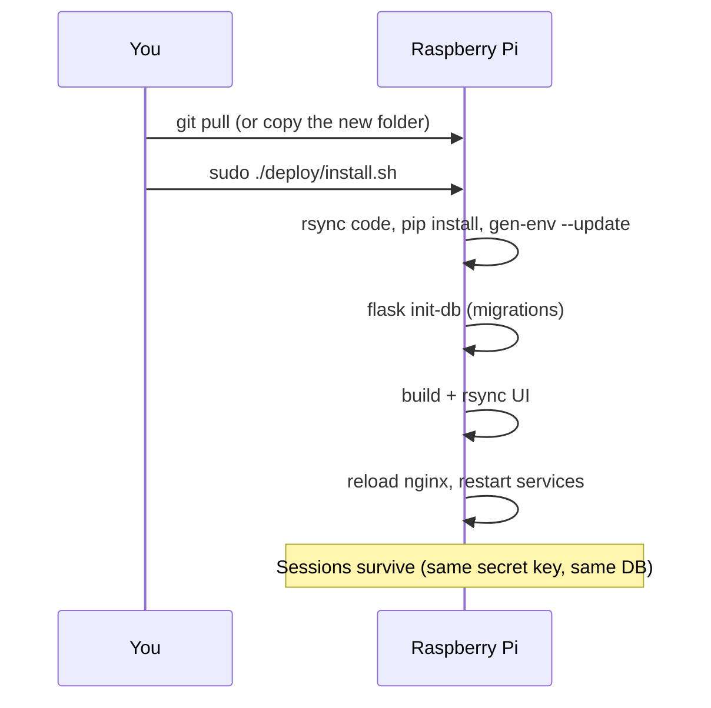
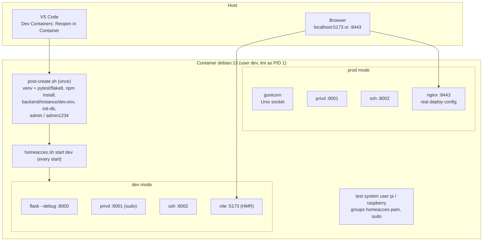

# 6. Deployment and operations

[← Frontend](05-frontend.md) · [Index](README.md)

Target: **Raspberry Pi with Debian 13 (trixie) / Raspberry Pi OS**. Everything needed is in
`deploy/`:

| File | Installed to | Purpose |
|---|---|---|
| `install.sh` | — | Installs or updates everything (idempotent) |
| `create-admin.sh` | — | Creates/promotes an admin via the Flask CLI |
| `gen-env.sh` | — | Generates `/etc/homeacces/homeacces.env` |
| `homeacces.env.example` | template for the env file | Single source of default settings |
| `nginx/homeacces.conf` | `/etc/nginx/sites-available/homeacces` (+ symlink in `sites-enabled`) | TLS site, headers, routing |
| `nginx/homeacces-proxy.conf` | `/etc/nginx/snippets/homeacces-proxy.conf` | Common `proxy_pass` settings for the API |
| `nginx/homeacces-headers.conf` | `/etc/nginx/snippets/homeacces-headers.conf` | Security headers, included in every location that sets its own headers |
| `systemd/homeacces.socket` | `/etc/systemd/system/` | API socket `/run/homeacces-api.sock`, only `www-data` may connect |
| `systemd/homeacces.service` | `/etc/systemd/system/` | gunicorn API, hardened |
| `systemd/homeacces-privd.service` | `/etc/systemd/system/` | Root helper (PAM + terminal) |
| `systemd/homeacces-ssh.service` | `/etc/systemd/system/` | SSH terminal (OpenSSH client), user `homeacces`, hardened |
| `pam.d/homeacces` | `/etc/pam.d/homeacces` | PAM stack: `common-auth` + `common-account` |
| `logrotate/homeacces` | `/etc/logrotate.d/homeacces` | Weekly rotation of the activity log, 52 kept |

## 6.1 Deployment topology



## 6.2 First installation

```bash
# on the Pi
git clone <this repo> homeacces && cd homeacces    # or copy the folder
sudo ./deploy/install.sh
sudo ./deploy/create-admin.sh admin                # prompts for the password twice

# optional: allow a system user to sign in with PAM and use the web terminal
sudo usermod -aG homeacces-pam pi
```

Then open `https://<pi-hostname>.local/`. The certificate is self-signed, so the browser warns once.
The SSH menu is available to every user right away; switch it off in Admin → Settings if you do
not want users to open SSH connections from the Pi.

### What `install.sh` does



The backend code in `/opt/homeacces` is **root-owned** on purpose: the root helper runs it, so no
other user (including `homeacces`) may be able to modify it.

Two other choices in `install.sh` are about safety:

- Flask commands (`init-db`, and `create-admin` in `create-admin.sh`) run as `homeacces`, which reads
  the env file itself. The settings are never passed as command-line arguments, which every local
  user can read in `ps` — that would expose the secret key.
- The UI is built with `npm ci` (exactly the versions in `package-lock.json`) as the **owner of the
  source folder**, because npm runs install scripts of dependencies. If the folder belongs to root,
  the script warns and builds as root; clone the project as a normal user to avoid that.

## 6.3 Files on the Pi

```
/opt/homeacces/
├── backend/                 code (root:root, 0644/0755)
│   ├── app/ …
│   ├── homeacces_privd/ …
│   ├── homeacces_ssh/ …
│   ├── webterm.py
│   └── wsgi.py
└── venv/                    Python virtualenv (Flask, PyJWT, gunicorn, websockets)

/var/www/homeacces/          React build (root-owned)
├── index.html
└── assets/index-<hash>.js, index-<hash>.css

/etc/homeacces/homeacces.env           root:homeacces 0640 — configuration + secret key
/etc/ssl/homeacces/homeacces.{crt,key} TLS certificate (key 0600)
/etc/nginx/sites-available/homeacces   site config (symlinked in sites-enabled)
/etc/nginx/snippets/homeacces-proxy.conf
/etc/nginx/snippets/homeacces-headers.conf
/etc/systemd/system/homeacces.socket
/etc/systemd/system/homeacces.service
/etc/systemd/system/homeacces-privd.service
/etc/systemd/system/homeacces-ssh.service
/etc/pam.d/homeacces
/etc/logrotate.d/homeacces

/var/lib/homeacces/homeacces.sqlite3   homeacces:homeacces — database (+ -wal, -shm)
/var/lib/homeacces/ssh/known_hosts/    homeacces 0700 — accepted SSH host keys, one file per user id
/var/log/homeacces/activity.log        homeacces:homeacces 0640 — audit log
/run/homeacces/privd.sock              root:homeacces 0660 — helper socket (runtime)
/run/homeacces-api.sock                www-data 0600 — API socket (from homeacces.socket)
```

## 6.4 Configuration (`/etc/homeacces/homeacces.env`)

Generated by `deploy/gen-env.sh` from `homeacces.env.example` with a fresh random secret. Written
atomically, owned `root:homeacces`, mode `0640`. See [Backend §2.4](02-backend.md#24-configuration-appconfigpy)
for every variable.

```bash
sudo ./deploy/gen-env.sh --registration --idle 15      # first time: allow self-registration (off by default)
sudo ./deploy/gen-env.sh --force --no-pam              # rebuild from defaults, keep secret, back up old file
sudo ./deploy/gen-env.sh --force --no-ssh              # SSH menu off by default (admins can still switch it on)
sudo ./deploy/gen-env.sh --force --rotate-secret       # new secret key → everyone is signed out
sudo ./deploy/gen-env.sh --update                      # add settings introduced by newer versions
./deploy/gen-env.sh --print                            # preview only
./deploy/gen-env.sh --help
```

After editing the file by hand:

```bash
sudo systemctl restart homeacces homeacces-privd homeacces-ssh
```

> All three services read the same file and so share `HOMEACCES_SECRET_KEY`: the API signs
> terminal and SSH tickets, the helper and homeacces-ssh verify them.

`HOMEACCES_SSH_ENABLED` is only the initial value of the SSH menu switch: once an admin changes it
in Admin → Settings, the setting in the database wins.

## 6.5 nginx



Headers sent on every response (from `snippets/homeacces-headers.conf`): `Strict-Transport-Security`,
`Content-Security-Policy`, `X-Frame-Options: DENY`, `X-Content-Type-Options: nosniff`,
`Referrer-Policy: same-origin`. nginx forgets server-level `add_header`s in any `location` that
sets its own (like `Cache-Control`), so those locations include the snippet again — keep doing that
when you add one.
`server_tokens off`, `client_max_body_size 64k`, gzip for CSS/JS/JSON/SVG.

### Using a real certificate

For a publicly reachable Pi, replace the self-signed files, e.g. with certbot:

```bash
sudo apt install certbot
sudo certbot certonly --webroot -w /var/www/homeacces -d home.example.org
sudo ln -sf /etc/letsencrypt/live/home.example.org/fullchain.pem /etc/ssl/homeacces/homeacces.crt
sudo ln -sf /etc/letsencrypt/live/home.example.org/privkey.pem   /etc/ssl/homeacces/homeacces.key
sudo systemctl reload nginx
```

(`install.sh` only generates a certificate when `homeacces.crt` does not exist, so re-running it
keeps yours.)

## 6.6 systemd services



| | `homeacces.service` | `homeacces-privd.service` | `homeacces-ssh.service` |
|---|---|---|---|
| Command | `gunicorn --workers 2 wsgi:app` (socket from `homeacces.socket`) | `python -m homeacces_privd` | `python -m homeacces_ssh` |
| User | `homeacces` | `root` | `homeacces` |
| Restart | on-failure, 3 s | on-failure, 3 s | on-failure, 3 s |
| Writable | `/var/lib/homeacces`, `/var/log/homeacces` only | whole system (shells must behave like SSH logins) | `/var/lib/homeacces` only (known_hosts files) + private `/tmp` (key files of open sessions) |
| Hardening | `NoNewPrivileges`, `ProtectSystem=strict`, `ProtectHome`, `PrivateTmp`, `PrivateDevices`, empty `CapabilityBoundingSet`, `RestrictAddressFamilies`, `RestrictSUIDSGID`, … | `ProtectKernelModules/Logs`, `ProtectClock`, `RestrictRealtime`, `LockPersonality`, `UMask=0077`, `KillMode=mixed` | as `homeacces.service` but without `PrivateDevices` (ssh needs `/dev/tty` and PTYs), `UMask=0077` |

Raise `--workers` on a Pi 5 if needed (rule of thumb: 2 × cores; each worker uses ~30–40 MB).

## 6.7 Updating



### Building the UI elsewhere (slow Pi)

Building with Node on a Pi 3 or older is slow. Build on another machine and copy the result:

```bash
# on a faster machine
cd frontend && npm ci && npm run build
rsync -a dist/ pi@raspberrypi.local:homeacces/frontend/dist/

# on the Pi
sudo SKIP_FRONTEND_BUILD=1 ./deploy/install.sh
```

## 6.8 User management from the command line

```bash
sudo ./deploy/create-admin.sh alice          # create admin, or reset password + promote
sudo usermod -aG homeacces-pam pi            # allow PAM login + terminal
sudo gpasswd -d pi homeacces-pam             # revoke (effective at next refresh, ≤ 15 min)
sudo usermod -aG sudo pi                     # PAM user becomes web admin (at next refresh)
```

## 6.9 Logs and monitoring

| What | Command |
|---|---|
| API + helper + SSH logs | `journalctl -u homeacces -u homeacces-privd -u homeacces-ssh -f` |
| HTTP access/errors | `/var/log/nginx/access.log`, `/var/log/nginx/error.log` |
| Activity / audit | Admin → Activity log, or `tail -f /var/log/homeacces/activity.log` |
| Service status | `systemctl status homeacces homeacces-privd homeacces-ssh nginx` |
| Health check | `curl -sk https://localhost/api/health` → `{"status":"ok"}` |

## 6.10 Backups

```bash
# database (consistent online snapshot)
sudo sqlite3 /var/lib/homeacces/homeacces.sqlite3 ".backup /root/homeacces-$(date +%F).sqlite3"
# configuration (contains the secret key — keep it private)
sudo cp /etc/homeacces/homeacces.env /root/homeacces.env.bak
# users' accepted SSH host keys (optional)
sudo tar -czf /root/homeacces-ssh-$(date +%F).tgz -C /var/lib/homeacces ssh
```

The database contains the users' saved SSH private keys (unencrypted): keep backups private.

Example nightly cron (`sudo crontab -e`):

```
30 3 * * * sqlite3 /var/lib/homeacces/homeacces.sqlite3 ".backup /root/backup/homeacces-$(date +\%F).sqlite3" && find /root/backup -name 'homeacces-*.sqlite3' -mtime +30 -delete
```

Restore steps are in [Database §3.6](03-database.md#36-maintenance).

## 6.11 Development environments

### Dev container (Docker, Debian 13) — recommended

`.devcontainer/` reproduces the Pi: Python, Node, nginx, PAM, the terminal and the SSH client.



| Account | Sign in as | Password | Gets |
|---|---|---|---|
| `admin` | HomeAcces account | `admin1234` | web admin |
| `pi` | System account (PAM) | `raspberry` | web admin + terminal |

```bash
.devcontainer/homeacces.sh start dev    # Flask --debug + Vite → http://localhost:5173 (default)
.devcontainer/homeacces.sh start prod   # gunicorn + real nginx config → https://localhost:8443
.devcontainer/homeacces.sh status | stop | restart [mode] | logs [api|privd|ssh|ui|nginx]
cd backend && .venv/bin/python -m pytest
```

Without VS Code: `devcontainer up --workspace-folder .` then `devcontainer exec --workspace-folder . bash`.
`homeacces.sh` only works **inside** the container.

### Local development without Docker

```bash
# API
cd backend
python3 -m venv .venv && .venv/bin/pip install -r requirements.txt pytest
export HOMEACCES_SECRET_KEY=$(python3 -c 'import secrets; print(secrets.token_urlsafe(48))') HOMEACCES_COOKIE_SECURE=0
.venv/bin/flask --app wsgi.py init-db
.venv/bin/flask --app wsgi.py create-admin admin
.venv/bin/flask --app wsgi.py run --port 8000 --debug

# UI (second terminal)
cd frontend && npm install && npm run dev     # http://localhost:5173
```

PAM login and the terminal additionally need the helper running as root
(`sudo -E .venv/bin/python -m homeacces_privd` with `HOMEACCES_PRIVD_SOCKET` pointing to a
writable path) and `HOMEACCES_PAM_ENABLED=1` for the API. The SSH menu needs `homeacces-ssh`, run as
your own user with the same environment (`.venv/bin/python -m homeacces_ssh`, port 8002) and the
`ssh` client installed.

## 6.12 Troubleshooting

| Symptom | Likely cause | Fix |
|---|---|---|
| `homeacces` fails: *HOMEACCES_SECRET_KEY must be set…* | Env file missing or secret < 32 chars | `sudo ./deploy/gen-env.sh --force` |
| 502 Bad Gateway on `/api/*` | gunicorn or its socket not running | `systemctl status homeacces.socket homeacces`, `journalctl -u homeacces` |
| PAM login: *system authentication service unavailable* (503) | Helper not running / socket missing | `systemctl status homeacces-privd`; check `/run/homeacces/privd.sock` |
| PAM login: *invalid username or password* with correct password | User not in `homeacces-pam`, uid < 1000, or account locked | `id <user>`; `sudo usermod -aG homeacces-pam <user>`; check `journalctl -u homeacces-privd` |
| Terminal closes with *bad origin* | Accessed through a proxy that rewrites `Host` | Make `Origin` host match `Host` (nginx sets `Host $http_host`) |
| Terminal closes with *too many open terminals* | > 4 sessions for the user (local and SSH are counted separately) | Close other tabs |
| SSH terminal shows *[connection closed]* right away | `homeacces-ssh` not running (nginx logs a 502) | `systemctl status homeacces-ssh`, `journalctl -u homeacces-ssh` |
| SSH: *Host key verification failed* / *REMOTE HOST IDENTIFICATION HAS CHANGED* | The server's key differs from the one the user accepted earlier | If the change is expected (server reinstalled): SSH → **Forget host key**, then connect and check the new key |
| SSH: **Connect** disabled, ticket 403 | An admin switched the SSH menu off | Admin → Settings → SSH terminal |
| Signed out every 15 min | Refresh failing — clock skew or cookies blocked | Check Pi time (`timedatectl`), browser cookie settings |
| Login works over IP but cookies are missing in dev | `Secure` cookies on plain HTTP | `HOMEACCES_COOKIE_SECURE=0` in development only |
| 429 *too many failed attempts* | Throttling (app or nginx) | Wait 15 min (app) / 1 min (nginx) |
| Everyone signed out after update | Secret key changed | Expected after `--rotate-secret` |
| 429 on *Change password* | 5 wrong current passwords in 15 min | Wait 15 min |
| "Register" link missing on the login page | Self-registration is off by default | Admin → Settings, or `gen-env.sh --registration` for new installs |
| `nginx -t` fails after install | Another site is `default_server` | Remove the conflicting site in `/etc/nginx/sites-enabled/` |
