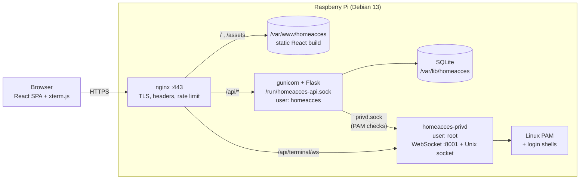

# HomeAcces — technical documentation

This folder explains how the HomeAcces website works, from the browser down to the SQLite file
and the Raspberry Pi system accounts.

| # | Document | What it covers |
|---|---|---|
| 1 | [Architecture overview](01-architecture.md) | Components, processes, ports, trust boundaries, request routing |
| 2 | [Backend (Flask API)](02-backend.md) | App factory, blueprints, request lifecycle, every endpoint, activity log, item types, privileged helper |
| 3 | [Database (SQLite)](03-database.md) | Schema, ER diagram, dynamic `item_type_<id>` tables, migrations, maintenance |
| 4 | [Authentication & security](04-authentication.md) | Local and PAM login, JWT, cookies, CSRF, refresh rotation, throttling, web terminal tickets |
| 5 | [Frontend (React)](05-frontend.md) | Component tree, routing, API client, auth state, pages, web terminal |
| 6 | [Deployment & operations](06-deployment.md) | Install on the Pi, files on disk, nginx, systemd, configuration, dev container, updates, backups, troubleshooting |

## The project in one picture



## Tech stack

| Layer | Technology | Version (pinned) |
|---|---|---|
| Reverse proxy / static files | nginx | Debian 13 package |
| API | Python 3, Flask | Flask 3.1.3 |
| WSGI server | gunicorn (2 workers) | 23.0.0 |
| Tokens | PyJWT (HS256) | 2.15.0 |
| Terminal transport | `websockets` (asyncio) | 14.1 |
| Database | SQLite 3 (WAL mode) | Debian 13 package |
| UI | React + React Router | 18.3.1 / 6.30.6 |
| Build tool | Vite (Rolldown) | 8.3.5 |
| Terminal emulator | xterm.js + fit addon | 5.5.0 / 0.10.0 |
| System login | Linux-PAM through `ctypes` | Debian 13 package |

## Reading the diagrams

The diagrams are written in [Mermaid](https://mermaid.js.org/). They render directly on GitHub,
GitLab, and in VS Code (built-in Markdown preview with the *Markdown Preview Mermaid Support*
extension). Elsewhere, paste a block into <https://mermaid.live> to see it.

## Source map

```
backend/
  wsgi.py                 entry point for gunicorn / flask CLI  → see 02-backend.md
  app/                    the Flask API (runs as user homeacces) → 02, 03, 04
  homeacces_privd/        the root helper: PAM + terminal        → 02 (§ privileged helper), 04
  tests/                  pytest suite
frontend/
  src/                    React SPA                              → 05-frontend.md
deploy/                   install scripts, nginx, systemd, PAM   → 06-deployment.md
.devcontainer/            Docker dev environment (Debian 13)     → 06-deployment.md
```

## License

HomeAcces is released under the [MIT License](../LICENSE).
Copyright © 2026 Juan Maria Gomez Lopez <juan-maria.gomez-lopez@tutamail.com>.
